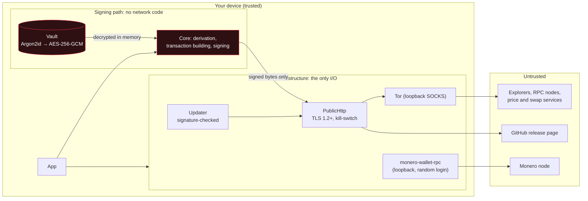

# Product Security Baseline — conformance

Phobia Wallet measured against the **Altumptic Product Security Baseline (PSB) v1.0**, the security
standard for software under the Altumptic / thefear mark.

*Self-assessed by the maintainer on 29 October 2026, against the code that will ship in the next Beta.
This is not an independent audit; there has been none ([AUDIT_STATUS.md](../AUDIT_STATUS.md)). Each
"yes" below links to the file, test or command that proves it. Where Phobia falls short, this page says
so, and every exception has an end date ([§12](#12-exceptions)).*

## Labels

`PSB-A` · `SIGNED` · `ATTESTED` · `SBOM` · `NO-TELEMETRY` · `TOR-CAPABLE` · `FAIL-CLOSED` · `LOCAL-FIRST` · `AUDIT:NONE` · `DISCLOSURE:OK`

| Label | What it means for Phobia | Proof |
|---|---|---|
| **PSB-A** | Class A, custody: the wallet holds your keys, so the full baseline applies, plus the Key Custody addendum. Four exceptions are open; see [§12](#12-exceptions). | this page |
| **SIGNED** | Windows programs carry an Authenticode signature (self-signed certificate). The APK is signed with one stable key. From the next release, the checksum list carries an RSA-4096 signature that the updater checks. | [keys/](../keys/README.md), [BUILD_VERIFY.md](BUILD_VERIFY.md) |
| **ATTESTED** | Every release file and the checksum list carry GitHub build provenance (Sigstore), since 4.8.0. | `gh attestation verify` |
| **SBOM** | An SPDX bill of materials is attached to every release since 8 October 2026. | release page |
| **NO-TELEMETRY** | No analytics, no crash reports, no usage pings. Every server the code can contact is listed, and a test fails the build if one is missing. | [PRIVACY.md](../PRIVACY.md), `NetworkCounterpartyTests` |
| **TOR-CAPABLE** | Tor is bundled on every platform. It is **off until you switch it on**, so the label is not TOR-DEFAULT. | [docs/TOR.md](TOR.md) |
| **FAIL-CLOSED** | With Tor-only on, a request that cannot go through Tor is refused before a socket opens. An update the wallet cannot attribute to the project is deleted, not run. | `KillSwitchTests`, `NetworkIsolationTests`, `ReleaseSignatureTests` |
| **LOCAL-FIRST** | The project runs no servers. Keys, notes and history stay on the device. | [THREAT_MODEL.md](../THREAT_MODEL.md) |
| **AUDIT:NONE** | No independent security audit yet. | [AUDIT_STATUS.md](../AUDIT_STATUS.md) |
| **DISCLOSURE:OK** | Private reports via GitHub Security Advisories, acknowledged within 72 hours. | [SECURITY.md](../SECURITY.md), [security.txt](../.well-known/security.txt) |

## 0. Principles

| Principle | How it shows |
|---|---|
| P1 Open by default | MIT-licensed. Only standard primitives, no home-made ciphers; where no .NET library exists (BLAKE-256, sr25519, Merlin/STROBE) they are implemented in the open and pinned to their reference vectors. The wallet's own assemblies rebuild byte for byte ([BUILD_VERIFY.md](BUILD_VERIFY.md)). |
| P2 Least data | No account, email or KYC; no telemetry. The price list asks for one fixed set of coins for everyone, so the price service cannot tell wallets apart. |
| P3 Prove, don't claim | Each row on this page names its proof. Release claims can be checked without trusting the project ([BUILD_VERIFY.md](BUILD_VERIFY.md)). |
| P4 Fail closed | Kill-switch, signed updates, sends settled by transaction id rather than retried blind; details in [§4](#4-architecture-and-reliability). |
| P5 Authorized scope | A wallet for your own funds; nothing in it acts on other people's systems. |
| P6 Name the limits | [THREAT_MODEL.md](../THREAT_MODEL.md), the README's "honest part", and [known limits](#known-limits) below. |

## 2. Cryptography and data protection

### 2.1 What is used, and where

Chosen by Phobia:

| Purpose | Primitive | Where |
|---|---|---|
| Vault (recovery phrase) | **Argon2id** (64 MiB, 4 passes, 2 lanes) → **AES-256-GCM**; format version in the associated data | `EncryptedFileSeedVault` |
| Notes, exchange API keys, address book, explorer key | **HKDF-SHA256** from the recovery phrase, a separate context per store → **AES-256-GCM**, store name as associated data. The older format still opens and is rewritten on first read. | `SealedFile`, `SealedFileTests` |
| History, activity log, swaps, cached balances, watched addresses, found accounts | the same, keyed by the wallet's secret **and** passphrase, one file per wallet and secret, so the decoy behind the duress password and a hidden wallet each have their own | `WalletDataKey`, `WalletDataSealingTests`, `DuressRecordsTests` |
| Watch-only wallet description | **HKDF-SHA256** from a random 256-bit key held in the vault → **AES-256-GCM** | `WatchWalletFile` |
| Panic-password check | **Argon2id** (19 MiB, 2 passes), constant-time comparison | `PanicGuard`, `PanicPasswordTests` |
| Randomness (keys, nonces, salts, peer choice) | the operating system's CSPRNG (`RandomNumberGenerator`) | everywhere |
| Transport | **TLS 1.2 or 1.3** only, certificates validated by the system | `PublicHttp.AllowedTls`, `ReleaseSignatureTests` |
| Checksum-list signature | **RSA-4096**, PKCS#1 v1.5, SHA-256 | `ReleaseSignature`, `sign-checksums.ps1` |
| Windows code signing | Authenticode, RSA-4096 / SHA-256, RFC 3161 timestamp | `sign-windows.ps1` |
| Build provenance | Sigstore keyless (GitHub OIDC) | `release.yml` |

Set by each network's protocol. The wallet must use these or the network rejects the transaction; they
are not choices Phobia made:

| Purpose | Primitive | Why it is allowed here |
|---|---|---|
| Transaction signatures | secp256k1 ECDSA and BIP-340 Schnorr (Bitcoin family, EVM, TRON, Cosmos, XRP, Zcash, Decred), Ed25519 (Solana, Stellar, NEAR, TON, Cardano; Nano's Blake2b variant), sr25519 (Polkadot), Monero's own scheme | Protocol-mandated: no other signature is valid on these chains. |
| Phrase → seed | PBKDF2-HMAC-SHA512 (BIP-39: 2,048 rounds; Cardano Icarus, Polkadot, TON variants) | Derives keys from a high-entropy phrase. It is **not** the password protection: the vault password goes through Argon2id only. |
| Address and transaction formats | RIPEMD-160, Keccak-256, BLAKE2b, BLAKE-256, double SHA-256 | Fixed by each chain's protocol; Phobia uses them to match the chain, not as its own security hash. |

Not used anywhere by Phobia's own code: MD5, SHA-1 for security, AES-ECB, AES-CBC, RC4, 3DES, DSA, RSA
under 2048 bits, SSL or TLS 1.0/1.1. The one MD5 on the device belongs to `monero-wallet-rpc`'s HTTP Digest
login on loopback; see exception [E-4](#12-exceptions).

**Post-quantum:** chain signatures change when each network changes them; a wallet cannot add a layer
the network would not accept. The vault and the sealed stores are symmetric (AES-256-GCM behind
Argon2id/HKDF), which quantum computers weaken but do not break the way they break elliptic-curve keys.

### 2.2 Keys and secrets

- Keys are made and kept on the device. The wallet writes **no logs** and has **no crash reporter**, so
  there is nothing for a key to leak into ([SECURITY_REVIEW.md §1](SECURITY_REVIEW.md#1-can-a-secret-reach-a-log-the-console-or-another-process)).
- Key buffers are wiped after use where .NET allows it. The recovery phrase while unlocked is a .NET
  `string`, which cannot be wiped; it is dropped at lock ([§2 of the review](SECURITY_REVIEW.md#2-is-memory-cleared-after-secrets-are-used)).
- Release signing keys live in GitHub Actions secrets and are loaded into memory only for the signing
  step. How a key would be replaced: [keys/README.md](../keys/README.md).
- Backup: the 24 words on paper, checked when the wallet is made. The optional backup file carries the
  encrypted vault, which still needs the vault password. Restoring from the words is tested against
  published vectors and other wallets' addresses; a backup file is checked before it is trusted: wrong
  password, a changed byte or a file that is not a backup are all refused (`VaultBackupVerifyTests`).

### 2.3 At rest and in transit

| Data | At rest |
|---|---|
| Recovery phrase (vault) | encrypted (Argon2id → AES-256-GCM) |
| Notes, exchange API keys, address book, explorer key, watch-only description | encrypted (HKDF → AES-256-GCM) |
| History, activity log, swaps, cached balances, watched addresses, found accounts | encrypted per wallet and secret (HKDF → AES-256-GCM); files from older versions are taken over and removed |
| Settings, the wallet list, address counters, cached prices and rates | **plain text, owner-only**; see exception [E-1](#12-exceptions) |

Every store is written whole and owner-only: `0600` in a `0700` folder on Linux, the profile's ACL on
Windows when the data is under `%APPDATA%` (a folder beside a portable copy takes its drive's
permissions), app-private storage on Android (`AtomicFile`, `DataFolderPermissionTests`).

In transit: TLS 1.2/1.3 everywhere; Tor on every platform, a separate circuit per purpose; with Tor-only
on, clearnet is blocked, not used as a fallback.

## 3. Release authenticity

| Artifact | Status |
|---|---|
| `SHA256SUMS-<label>.txt` for every file | ✅ every release, checked against the files before it is published |
| Signed checksums | ✅ Sigstore (keyless) signature over the list through the build attestation, since 4.8.0 · ✅ RSA-4096 detached signature `SHA256SUMS-<label>.txt.sig` from the next release; public key at [keys/phobia-release-signing.pem](../keys/phobia-release-signing.pem) |
| Provenance | ✅ `actions/attest-build-provenance` for every file, since 4.8.0; the bundle is attached to the release |
| SBOM | ✅ SPDX, since 8 October 2026 |
| Security notes in release notes | ✅ from the next release, a **Security** section in every release's notes ([template](RELEASE_CHECKLIST.md#release-notes-template)); before that, security changes were in the CHANGELOG |

| Platform | Signing |
|---|---|
| Windows | Authenticode on every `.exe`, timestamped. Self-signed: Windows shows "unknown publisher"; the thumbprint `89C2D871…C553` is what to check. |
| Android | APK signed with one stable key; SHA-256 fingerprint in [SECURITY.md](../SECURITY.md#verifying-what-you-run). |
| Linux | SHA-256 + Sigstore attestation; from the next release also the signed checksum list. |

## 4. Architecture and reliability

### 4.1 Trust boundaries

- **Signing path ≠ network path.** `Umbrella.Wallet.Core` holds derivation, building and signing, and is
  compiled without any networking library (`SigningPathIsolationTests`). The network sees signed bytes,
  never a key.
- Everything outside the device is untrusted: answers from explorers are cross-checked where it matters
  (a send that got no clear answer is settled by transaction id); the release page is believed only
  through the project's signatures.
- Local services listen on loopback only; the Monero service needs a random login that only this
  account can read.

### 4.2 Safe degradation

| | |
|---|---|
| Fail closed | Tor-only kill-switch (`KillSwitchTests`, `NetworkIsolationTests`); updates refused without the project's signatures (`ReleaseSignatureTests`, `WindowsSignatureTests`); a send with no clear answer is never re-broadcast blind. |
| Stable verify path | Checksum, attestation and signature commands are the same for every release; signing keys change only by the procedure in [keys/README.md](../keys/README.md). |
| Versioned formats | Vault (version in the associated data), sealed stores (`PSB2`, with the earlier format migrated on read), watch-only file (`PWS1`), panic check (fixed 48 bytes). |
| Incidents | Published in [SECURITY/VULNERABILITY_HISTORY.md](../SECURITY/VULNERABILITY_HISTORY.md), including issues found by our own review. |
| Reproducible builds | Partial: the wallet's own assemblies (Core, Infrastructure, App) rebuild byte for byte (CI `reproducible-build`); the installers and bundled packages do not yet. |

## 5.2 Desktop and mobile

- **Permissions.** Android asks for one: `INTERNET`. The desktop program runs as a normal user and needs
  no administrator rights to run.
- **Updates.** Only from this project's release page and only a newer version. Before anything is
  downloaded, the checksum list must carry the project's signature. After download, the file must match
  that list and GitHub's digest, and on Windows carry the project's Authenticode signature. Installing
  always takes your click. Both the check and the download can be turned off (Settings → Updates).
- **No debug builds on a release channel.** Releases are built in `Release` configuration by the release
  workflow only; the Android self-test build is CI-only and is never attached.

## 6. Privacy

- **Data inventory.** On the device: the table in [§2.3](#23-at-rest-and-in-transit), kept until you
  remove the wallet or use *Delete everything*. The panic password wipes the same set
  (`DataWiperCoverageTests`). Leaving the device: every server and what it learns is in
  [PRIVACY.md](../PRIVACY.md) and in Settings → Privacy.
- No account, no KYC, no analytics SDK. Third-party services (explorers, price and swap services) are
  listed with what each learns; any chain can be pointed at your own node.

## 7. Development

| Requirement | How |
|---|---|
| Threat model | [THREAT_MODEL.md](../THREAT_MODEL.md) |
| Pinned dependencies | NuGet lock files; every GitHub Action pinned to a commit SHA; Tor and Monero pinned to their projects' signed hashes |
| Audit in CI; critical CVEs block | `dotnet list package --vulnerable` fails the build; dependency review fails on high severity; Dependabot; CodeQL; Semgrep; gitleaks |
| CI secrets | Attestations use short-lived OIDC tokens. The two signing keys are Actions secrets (not in the repository), used only in the release workflow. |
| Second pair of eyes | One maintainer: every change goes through a pull request with required checks and automated review, and the maintainer's merge is the recorded sign-off. |
| Negative tests | Kill-switch with Tor absent; tampered, unsigned and foreign-signed updates; wrong passwords and damaged vault files; malformed addresses, amounts, PSBTs and payment links |
| Release checklist | [RELEASE_CHECKLIST.md](RELEASE_CHECKLIST.md) |

## 8. Vulnerability disclosure

- Policy: [SECURITY.md](../SECURITY.md); process: [SECURITY/COORDINATED_DISCLOSURE.md](../SECURITY/COORDINATED_DISCLOSURE.md).
- `security.txt`: [.well-known/security.txt](../.well-known/security.txt).
- Contact: [GitHub private security advisories](https://github.com/thefear078/Phobia-Wallet/security/advisories/new)
  (enabled); acknowledgement within 72 hours; safe harbour for good-faith research.

## 9. Evidence pack

| | |
|---|---|
| Security design notes | [docs/security-model.md](security-model.md), [docs/architecture.md](architecture.md), this page |
| Verify guide | [docs/BUILD_VERIFY.md](BUILD_VERIFY.md), [keys/README.md](../keys/README.md) |
| Threat model and non-goals | [THREAT_MODEL.md](../THREAT_MODEL.md) |
| Security changes per release | **Security** sections in [CHANGELOG.md](../CHANGELOG.md) and the release notes |
| Self-review | [docs/SECURITY_REVIEW.md](SECURITY_REVIEW.md) |

## 12. Exceptions

Each one has an end date and a compensating control. An exception past its date is a defect.

| ID | Deviation | Why | Until | Compensating control |
|---|---|---|---|---|
| E-1 | Settings, the wallet list and the address counters are plain text (§2.3). Narrowed on 2026-10-30: history, activity, swaps, balances, watched addresses and found accounts are now sealed. | Settings and the wallet list are needed before any wallet is open (language, theme, Tor and proxy before the first request; which wallets there are). The counters decide how far a wallet is scanned for its money, and moving them is a change of its own. | 2027-04-30 (review) | No keys, phrases, amounts, transactions or addresses in them; owner-only; *Delete everything* and the panic password remove them; full-disk encryption recommended in [THREAT_MODEL.md](../THREAT_MODEL.md). |
| E-2 | No dedicated security email or PGP key (§8). | One maintainer; a mailbox nobody watches is worse than none. | 2026-12-31 | GitHub private advisories, enabled and watched; Telegram for a private channel; 72-hour acknowledgement. |
| E-3 | `security.txt` is in this repository, not served from a website's `/.well-known/` (§8). | The project has had no website since v3.0.1. | 2026-12-31 | The file is published here with a stable URL, and the policy is in SECURITY.md. |
| E-4 | `monero-wallet-rpc` authenticates its loopback login with HTTP Digest, which uses MD5 (§2.1). | Set by the Monero daemon; it offers no other login. | 2027-04-30 (review) | Loopback only; a fresh random password per start, readable only by this account; Digest never sends the password itself. |

## Known limits

- **No external audit.**
- **Windows certificate is self-signed**, so SmartScreen shows "unknown publisher". A CA-issued
  certificate is on the roadmap (R.2).
- **Malware on your device, or someone at your unlocked computer, is out of scope**, as for every software wallet.
- **Tor is off until you switch it on**, and with Tor on and Tor-only off, a failed Tor start leaves the
  wallet direct (it says so).
- **Transparent chains are public.** Tor hides your IP, not the ledger; Privacy Radar shows what a send reveals.
- **Releases up to Beta 6** have no signed checksum list; the updater in the next Beta refuses releases without one.
- **The duress password has limits on disk.** Each password's records are sealed separately, so someone who can
  list the data folder can see that a wallet entry has more than one set. The address counters are kept per
  wallet entry, so the decoy may offer a later receive address than a brand-new wallet would.
